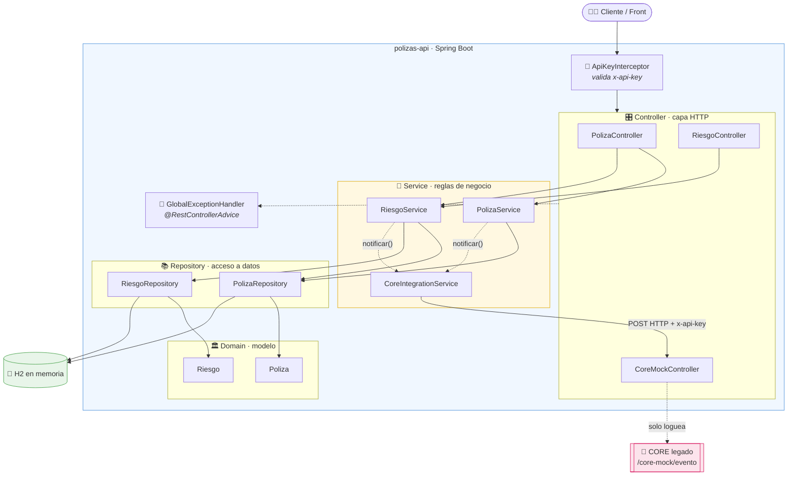
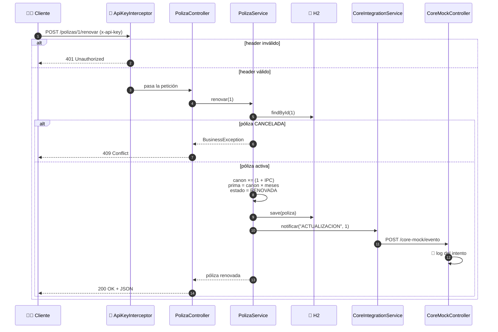
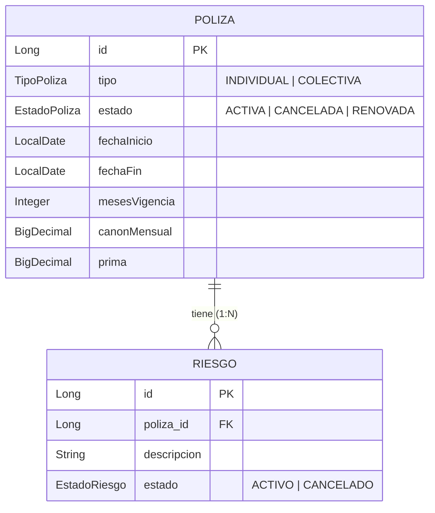

# 🛡️ polizas-api

> API REST para la gestión de pólizas de arrendamiento (individuales y colectivas).


Solución al **Módulo 2 – Prueba Técnica Práctica** del proceso de selección de
Desarrollador TI en Seguros Bolívar. 🚀

---

## 🧰 Stack

| Componente | Tecnología |
|:---|:---|
| ☕ Lenguaje | Java 21 |
| 🌱 Framework | Spring Boot 4.0.8 (Spring Web MVC) |
| 🗄️ Persistencia | Spring Data JPA + Hibernate |
| 💾 Base de datos | H2 en memoria |
| 📦 Build | Maven (wrapper incluido) |
| 🧰 Utilidades | Lombok, Bean Validation |

## ✅ Requisitos

- **JDK 17 o superior** (probado con JDK 25). Verificá con `java -version`.
- No hace falta instalar Maven: se usa el wrapper `./mvnw`.

## 🚀 Cómo ejecutar

```bash
./mvnw spring-boot:run
```

La aplicación queda en **`http://localhost:8080`**.
Al arrancar carga datos de ejemplo (una póliza individual y una colectiva) si
la base de datos está vacía.

## ⚙️ Configuración

Propiedades en `src/main/resources/application.properties`:

```properties
app.ipc=0.132                                        # IPC aplicado en la renovación (13.2%)
app.core.url=http://localhost:8080/core-mock/evento  # Servicio del CORE legado (mock)
app.api-key=123456                                   # Cabecera obligatoria x-api-key
```

## 🔐 Seguridad

Todas las peticiones deben incluir:

```http
x-api-key: 123456
```

Si falta o es inválida, la API responde **`401`** con el formato de error estándar.

---

## 🧭 Arquitectura

Arquitectura en capas: **controller → service → repository**, con el dominio
aislado y la integración con el CORE encapsulada.



### 🔄 Flujo de una renovación



### 🗃️ Modelo de datos



---

## 🔌 Endpoints

| Método | Ruta | Descripción |
|:---:|:---|:---|
| 🟢 `GET` | `/polizas?tipo=&estado=` | Lista pólizas filtrando (opcional) por tipo y estado |
| 🟢 `GET` | `/polizas/{id}/riesgos` | Lista los riesgos de una póliza |
| 🟡 `POST` | `/polizas/{id}/riesgos` | Agrega un riesgo (solo pólizas **COLECTIVA**) |
| 🟡 `POST` | `/polizas/{id}/renovar` | Renueva la póliza aplicando el IPC |
| 🟡 `POST` | `/polizas/{id}/cancelar` | Cancela la póliza y todos sus riesgos |
| 🟡 `POST` | `/riesgos/{id}/cancelar` | Cancela un riesgo |
| 🔵 `POST` | `/core-mock/evento` | Mock del CORE legado: registra en logs el evento |

Valores válidos: `tipo` = `INDIVIDUAL` | `COLECTIVA`;
`estado` = `ACTIVA` | `CANCELADA` | `RENOVADA`.

### 📬 Ejemplos

```bash
# Listar pólizas colectivas activas
curl -H 'x-api-key: 123456' 'http://localhost:8080/polizas?tipo=COLECTIVA&estado=ACTIVA'

# Riesgos de la póliza 2
curl -H 'x-api-key: 123456' http://localhost:8080/polizas/2/riesgos

# Agregar un riesgo a una póliza colectiva
curl -H 'x-api-key: 123456' -H 'Content-Type: application/json' \
     -d '{"descripcion":"Bodega 7 - Bogotá"}' \
     http://localhost:8080/polizas/2/riesgos

# Renovar la póliza 1 (incrementa canon y prima por IPC)
curl -X POST -H 'x-api-key: 123456' http://localhost:8080/polizas/1/renovar

# Cancelar la póliza 1 (cascada a sus riesgos)
curl -X POST -H 'x-api-key: 123456' http://localhost:8080/polizas/1/cancelar

# Cancelar un riesgo
curl -X POST -H 'x-api-key: 123456' http://localhost:8080/riesgos/1/cancelar
```

## 📜 Reglas de negocio

- 🎯 Una póliza **individual** solo puede tener **1 riesgo** (por eso solo las
  colectivas admiten agregar riesgos).
- 🚫 **No se puede renovar** una póliza cancelada.
- 🧨 La **cancelación de una póliza cancela todos sus riesgos** en cascada.
- 🚫 **Agregar un riesgo exige** que la póliza sea `COLECTIVA`.
- 📡 Toda acción que modifique estado **notifica al CORE** legado.

## 📁 Estructura del proyecto

```
src/main/java/com/segurosbolivar/polizasapi/
├── ⚙️ config/       ApiKeyInterceptor, WebConfig, DataSeeder
├── 🎛️ controller/   PolizaController, RiesgoController, CoreMockController
├── 🏛️ domain/       Poliza, Riesgo y enums de estado/tipo
├── 📦 dto/          PolizaResponse, RiesgoRequest/Response, CoreEventoRequest
├── 🚨 exception/    BusinessException, ApiError, GlobalExceptionHandler
├── 📚 repository/   PolizaRepository, RiesgoRepository
└── 🧠 service/      PolizaService, RiesgoService, CoreIntegrationService
```

## 🧪 Pruebas

```bash
./mvnw test
```

Tests de integración con `MockMvc` + H2 que cubren las reglas de negocio y la
seguridad (401 sin api-key, renovación con IPC, cascada, solo colectivas, etc.).

## 🔁 Integración continua

GitHub Actions ejecuta `./mvnw test` en cada push y pull request a `main`
(ver `.github/workflows/ci.yml`).
